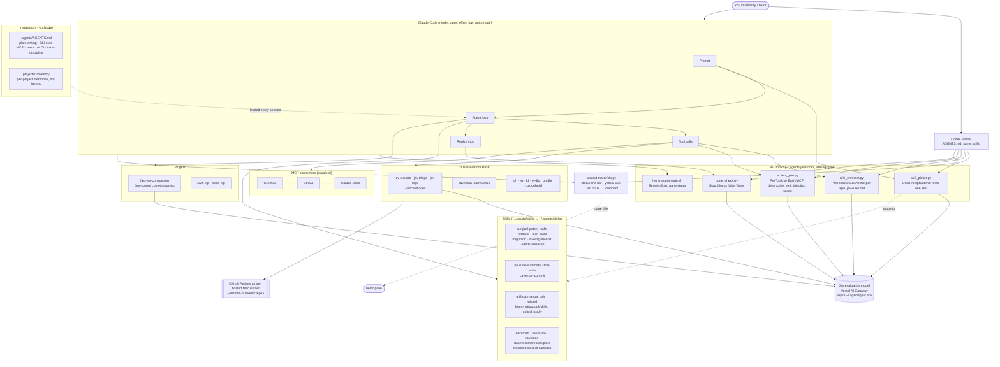

# AI agent architecture

How the Claude Code setup in `home/.claude` and `home/.agents` fits together, with shared Jev hooks also used by Codex. Snapshot of 2026-10-08.

## Layers

| Layer | Where | Role |
|---|---|---|
| Instructions | `.agents/AGENTS.md` (Claude imports it from `.claude/CLAUDE.md`; `.codex/AGENTS.md` links to it) | Global defaults: short replies, CLI before MCP, self-hosted CI, token discipline. |
| Settings | `.claude/settings.json` | Model, auto mode, hooks, plugins, skill on/off overrides. |
| Hooks | `.agents/jev/hooks/*.py` | Jev-backed guardrails. Each one fails open if Jev is unreachable. |
| Codex hooks | `.codex/hooks.json` | Runs the shared skill picker, rule enforcer, action gate, and done check. Codex requires a local `/hooks` trust review after restore. |
| Jev client | `.agents/jev/jev.py` ([`jev/`](../jev/)) | Stdlib client for the Jev evaluate endpoint (boolean, choice, score). |
| Skills | `.agents/skills/*`, `.claude/skills/*` | Linked into `~/.claude/skills`; Codex reads `.agents/skills` directly. CLI-wrapper skills live in `.agents/skills-disabled`, which neither agent loads. The skill picker only suggests skills the calling agent loads and Claude has not switched off. `grilling` and `wizard` are copies of [mattpocock/skills](https://github.com/mattpocock/skills) from 2026-10-17. `grilling` is manual-only in both agents (`disable-model-invocation` for Claude, `agents/openai.yaml` policy for Codex) and looks facts up with `rg` before using sub-agents. Re-apply both edits if you re-download it. |
| CLIs | `.local/bin/jev`, caveman | `jev` runs `.agents/jev/cli/{explore,triage}.py`. |
| Context meter | `.agents/context-meter/ctx.py` | Claude status line and Codex hook; shows context fill as a bar and sets the herdr pane title. |
| Plugins | `.claude/plugins/*.json`, `.agents/jev/fast-jev-compaction` | Context compaction and Swift/Kotlin LSP. |
| MCP | claude.ai account | COROS, Strava and Claude Docs. Managed in the claude.ai account, not in files. |

## Not in this repo

- `~/.agents/jev/.env` (gateway API key) and `~/.agents/jev/log/`.
- `~/.codex/config.toml` (machine-specific settings, MCP connections, and hook trust state) and Codex OAuth credentials.
- `~/.claude/projects/*/memory/` (personal memories), history, sessions, caches and `skills/synced/`.
- `node_modules` for fast-jev-compaction: run `npm install` in `.agents/jev/fast-jev-compaction` after restoring.
